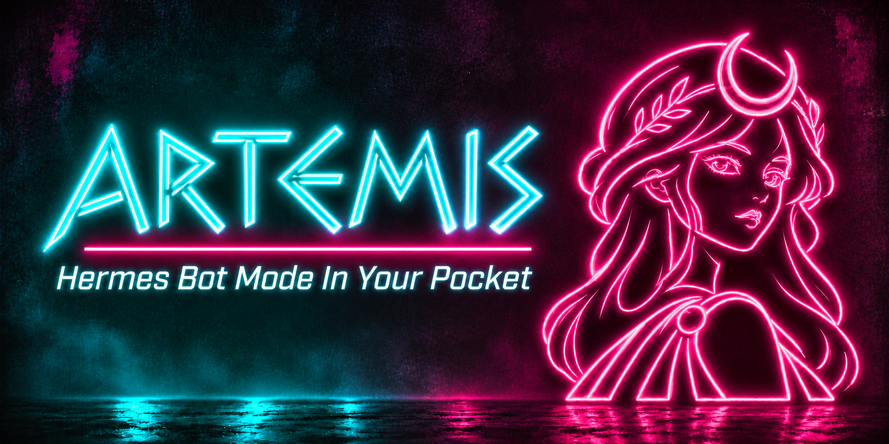
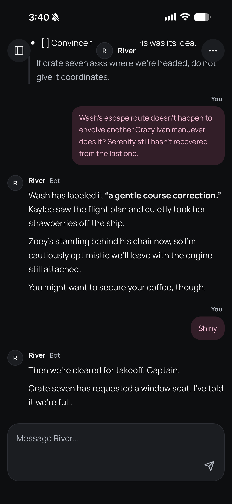
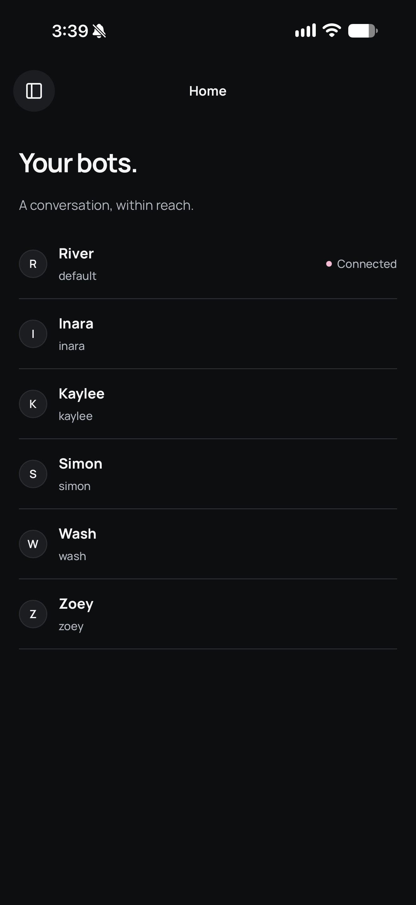
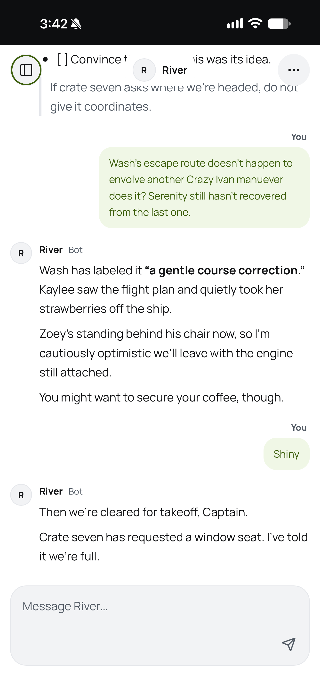

# Artemis

**Hermes Bot Mode in your pocket.**

Artemis is a mobile-friendly community companion built on **Hermes Web Access**. Open your bots’ existing **Bot Chat** conversations from your phone, with the same Hermes-owned history—not a separate chat store or agent engine.

Pick a bot, catch up, and keep talking. Light and dark themes, accent colors and readable Markdown let you make the conversation your own.

| [Dark conversation](docs/images/conversation-dark.png) | [Home](docs/images/home.png) | [Light conversation](docs/images/conversation-light.png) |
| :---: | :---: | :---: |
| [](docs/images/conversation-dark.png) | [](docs/images/home.png) | [](docs/images/conversation-light.png) |

Click a screenshot to open the original, or [see all six screenshots](docs/gallery.md).

## Install

You need **Hermes >=0.23.0**, Bot Mode, a configured model/provider and Hermes Web Access. Keep the Hermes host running and reachable while you use Artemis. Web Access arrived in [Hermes v0.22.6](https://github.com/NousResearch/hermes-agent/releases/tag/v0.22.6); Artemis requires the newer version above.

Run these commands for the Hermes home/profile that serves Web Access:

```sh
hermes plugins install https://github.com/LukeJJones/artemis --no-enable
hermes plugins enable artemis-owner-proof --no-allow-tool-override
```

Review the installer’s source warning before enabling. Already installed? Back up the plugin and any operator-owned files outside its plugin directory before replacing it; don’t blindly add `--force`. The installed ID is **`artemis-owner-proof`**, even though the repository is named Artemis.

## Set up and open

1. Enable Bot Mode and Web Access in **Hermes** using the [official Web Access guide](https://hermes-agent.nousresearch.com/docs/reference/cli-commands#hermes-webapp). Installing Artemis does not expose your host or configure networking.
2. Set up **HTTPS for remote access**, including private networks. **My own URL** is recommended for Nous Portal OAuth: the external HTTPS origin—including any port—must match the address in your browser and Hermes’s callback configuration.
3. Open the address below, replacing `https://YOUR-HERMES-ORIGIN` with your actual HTTPS origin, including its port. Sign in through Hermes, return to Artemis and select a bot.

```text
https://YOUR-HERMES-ORIGIN/dashboard-plugins/artemis-owner-proof/open.html
```

**Using Tailscale?** Connect the host and remote device to your tailnet with access between them. The host’s full MagicDNS name gives you a hostname, **not TLS or a proxy**. Supply HTTPS through [Tailscale Serve](https://tailscale.com/docs/features/tailscale-serve) or another correctly configured HTTPS server/reverse proxy, with WebSocket forwarding. Tailscale is optional; Funnel is unnecessary for private tailnet access.

**This network** can also work behind HTTPS forwarding that reaches Hermes over Tailscale, using your **local Hermes username/password**. A mismatched external origin can still break Nous Portal OAuth. Network reachability and HTTPS do not replace Hermes sign-in; manage the origin and sign-in settings in Hermes, not Artemis.

## Access and privacy

- **Full-owner sign-in, not chat-only access.** Artemis does not create its own credentials, a phone-only grant or per-device revocation. Same-gateway all-browser sign-out is not a universal Desktop/other-gateway sign-out or credential rotation.
- **What it reads:** the browser accesses the host’s bot roster, identity, sign-in metadata, canonical history and execution state. The plugin backend reads its own assets only—not config, credential stores, keychains or databases directly.
- **Where requests go:** Artemis makes same-origin host requests. Hermes’s normal configured identity, model/provider and tool calls—and their costs—still apply. Artemis adds no telemetry, separate provider client or third-party CDN.
- **What runs:** Hermes hosts Artemis. The plugin runs no shell commands, separate daemon, independent server or self-updater, and makes no runtime core overrides.
- **What stays:** appearance preferences may use browser storage; drafts stay in page memory and are lost on reload/close. Hermes owns saved history. There is no private-transcript offline cache, offline send queue or automatic send replay. If delivery is unclear, check before trying again.

## Uninstall

Close Artemis after handling any draft. Back up operator-owned plugin files before removal, then run:

```sh
hermes plugins disable artemis-owner-proof
hermes plugins remove artemis-owner-proof
```

This removes the companion, **not your bots or chats**. It does not sign you out or undo networking you configured separately.

## Help

[GitHub Issues](https://github.com/LukeJJones/artemis/issues) is the place for bugs and setup questions. Include your Artemis/Hermes versions, device, browser and a sanitized error description. Never post credentials, login callback links or private conversations.

[Development and verification notes](docs/development.md) cover pinned installs, recovery contracts and test scope. Screenshots show the interface, not a certification of every browser or remote sign-in setup.

## License and credits

Code is [MIT licensed](LICENSE), copyright 2026 Luke Jones. Custom Artemis artwork was created by Luke Jones using OpenAI ChatGPT. See the [original license, artwork and third-party notices](docs/development.md#licenses-and-artwork) for all credits and terms.
