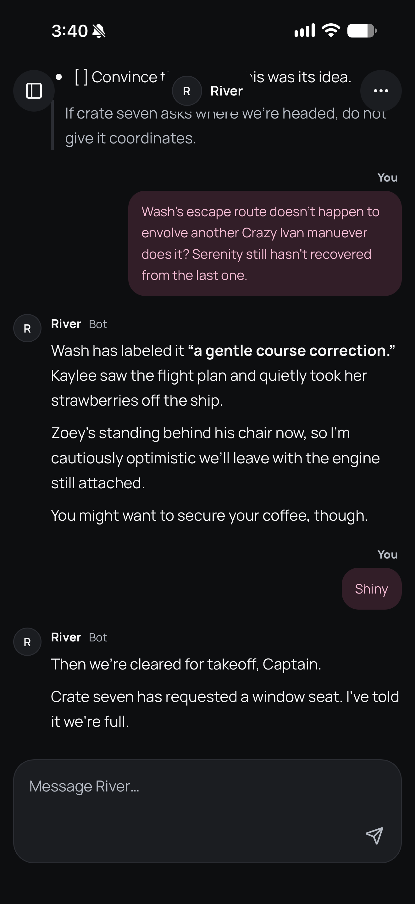
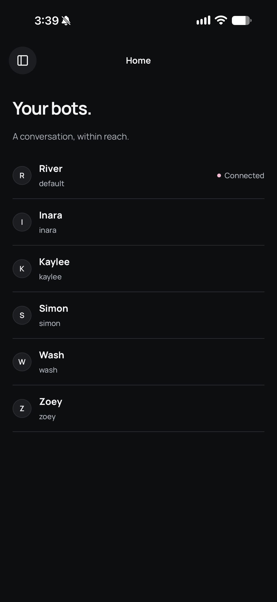
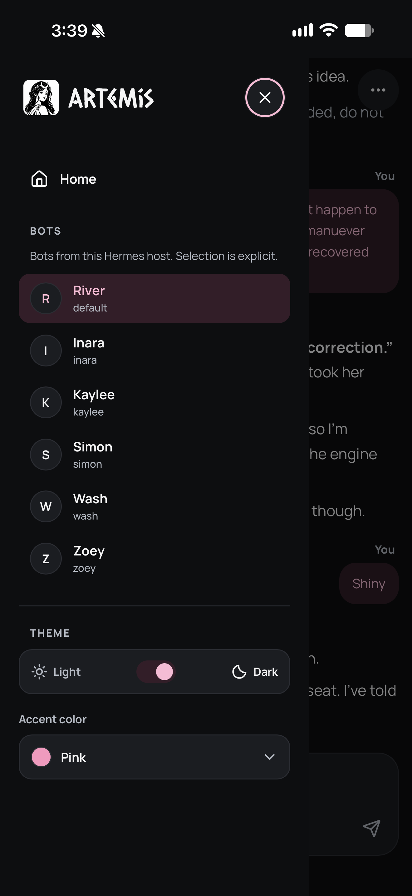
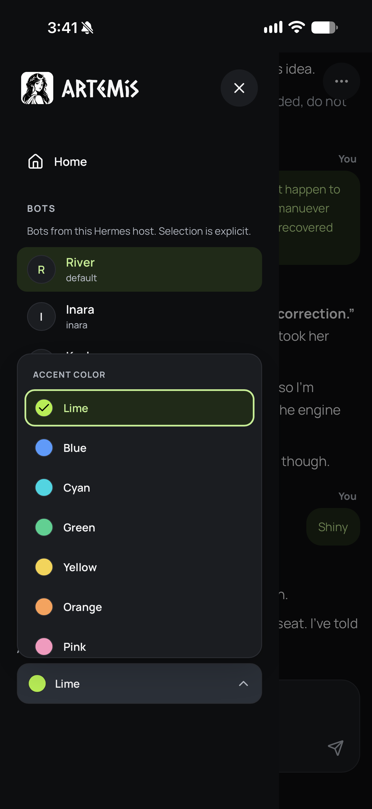
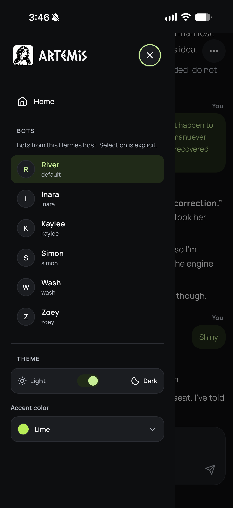
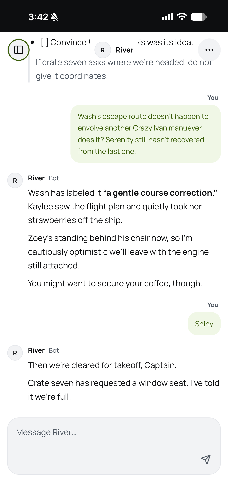

# Artemis screenshots

[Back to setup](../README.md)

Click any image for the full-size original. These owner-approved captures show the interface and a Firefly-themed conversation; they are not a compatibility or sign-in test certificate.

| Dark conversation | Home | Pink sidebar |
| :---: | :---: | :---: |
|  |  |  |

| Lime accent picker | Lime sidebar | Light conversation |
| :---: | :---: | :---: |
|  |  |  |

The six screenshots retain their original 1320 × 2868 pixels. The README banner retains its original 1774 × 887 pixels. Images are byte-for-byte copies of the approved originals, not resized or retouched exports.
